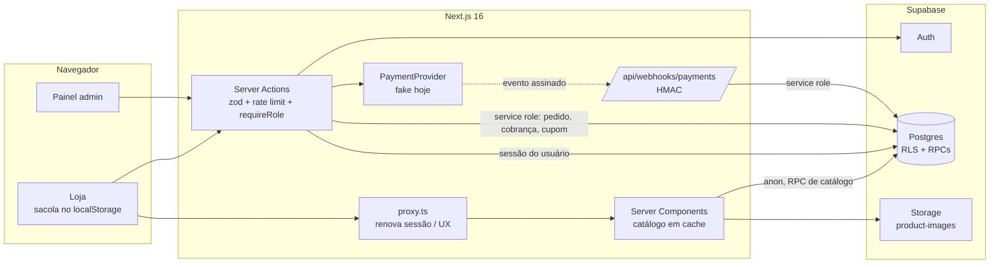
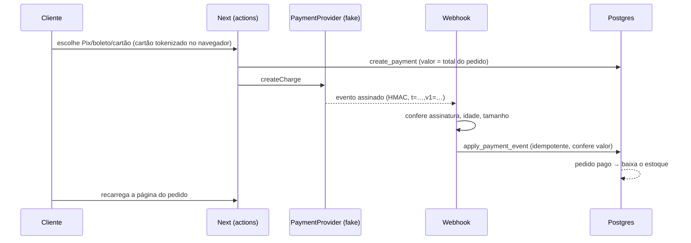

# Arquitetura — Sally Perfumaria

Visão de como o sistema está montado, para quem vai manter, avaliar ou comprar o projeto. Detalhes de tabelas em [DATA_MODEL.md](DATA_MODEL.md), segurança em [SECURITY.md](SECURITY.md), decisões em [DECISOES.md](DECISOES.md).

## Visão geral

Uma aplicação Next.js (loja + painel no mesmo projeto) sobre um único projeto Supabase. Não há servidor próprio nem fila: as regras de negócio que mexem com dinheiro e estoque são funções SQL transacionais no Postgres, e o Next chama essas funções com validação, sessão e limite de tentativas.



## Camadas

| Camada | Onde | Responsabilidade |
|---|---|---|
| Apresentação | `src/app/(loja)`, `src/app/admin`, `src/components` | Páginas, formulários, acessibilidade. Nenhum preço ou regra é decidido aqui |
| Ações e rotas | `src/app/**/actions.ts`, `src/app/api`, `src/app/auth/callback` | Validação zod, limite de tentativas, sessão (`getSessionUser` / `requireUser` / `requireRole`), chamada ao banco |
| Leitura | `src/lib/catalog/queries.ts`, `src/lib/admin/queries.ts`, `src/lib/account/queries.ts` | Consultas por domínio. Catálogo com `'use cache'`; painel e conta nunca em cache |
| Domínio no servidor | `src/lib/payments`, `src/lib/checkout`, `src/lib/auth`, `src/lib/security` | Provedor de pagamento, assinatura de webhook, esquemas, cabeçalhos |
| Dados | `supabase/migrations` | Tabelas, RLS, privilégios de coluna, RPCs transacionais, triggers de auditoria |

### Três clientes Supabase
| Cliente | Arquivo | Usado para |
|---|---|---|
| Público (anon, sem cookie) | `src/lib/supabase/public.ts` | Catálogo e cotação da sacola; pode entrar em cache |
| Servidor com sessão | `src/lib/supabase/server.ts` | Conta do cliente e painel: a RLS vê o usuário real |
| Service role | `src/lib/supabase/admin.ts` (`server-only`) | Só o que exige privilégio: criar pedido, cobrança, aplicar webhook, validar cupom, excluir conta. Sempre depois de validar a entrada |

Não existe cliente Supabase no navegador: toda chamada passa pelo servidor.

## Fluxos principais

### Catálogo
Server Components leem `search_catalog`, `get_product` e `catalog_facets` (RPCs `SECURITY INVOKER`, sujeitas à RLS) com `'use cache'`, `cacheLife("hours")` e a tag `catalog`. Quando o admin salva produto, preço, imagem ou estoque, a ação chama `updateTag("catalog")` e a loja reflete na hora. Imagens vêm do Storage pelo otimizador do Next.

### Sacola e checkout
1. A sacola fica no `localStorage` só com variante e quantidade (sincronizada entre abas).
2. A cada mudança, `quoteCart` pede ao banco preço atual, disponibilidade, frete e, se houver, o desconto do cupom (`quote_cart` / `quote_cart_coupon`).
3. No envio, `placeOrder` valida, limita tentativas por IP e e-mail, lê a sessão (opcional) e chama `create_order` com service role.
4. `create_order` trava o estoque em ordem fixa, recalcula tudo, revalida o cupom com a linha travada, reserva por 30 minutos e é idempotente pela chave gerada no navegador.
5. O cliente vai para `/pedido/<token>` (token de 64 hex, a credencial de quem comprou sem conta).

Reservas vencidas são liberadas sob demanda (início de cada pedido, cobrança ou listagem do painel), sem agendador.

### Pagamento

A tela do cliente nunca marca um pedido como pago. Trocar o provedor simulado por um real é implementar `PaymentProvider` (`src/lib/payments/types.ts`) e o parser de webhook do gateway; o banco não muda.

### Painel
`src/app/admin/(painel)/layout.tsx` exige `requireRole("admin")` no servidor. Escritas de catálogo passam pela RLS (`has_role('admin')`); estoque e status de pedido só por RPC com motivo e autor. Triggers gravam auditoria de catálogo, estoque, papéis, frete e cupons.

### Conta do cliente
Supabase Auth com cookies `httpOnly`. Perfil, endereços e favoritos são visíveis só pelo dono (nem o admin lê). Exportação em JSON e exclusão de conta pela própria pessoa.

## Renderização e cache (Next 16)
- `cacheComponents: true`: páginas são pré-renderizadas com "buracos" dinâmicos; o catálogo vem do cache, e sessão, sacola e painel são dinâmicos.
- Leitura de sessão só depois de `connection()` (a validação do JWT usa a hora atual, proibida na pré-renderização). Dado de sessão nunca entra em `'use cache'`.
- Login, cadastro e recuperação de senha são páginas estáticas que leem parâmetros no navegador, para funcionarem antes da hidratação.
- `proxy.ts` (antigo middleware) só renova a sessão e redireciona por conveniência; a autorização está no servidor e na RLS.

## Estrutura de pastas
```
src/
  app/(loja)/        loja: catálogo, sacola, checkout, pedido, conta, páginas de auth
  app/admin/         login e painel (produtos, estoque, pedidos, cupons, marcas, categorias)
  app/api/webhooks/  webhook de pagamento
  components/        ui (base), catalog, cart, account, admin, layout
  lib/               domínio e acesso a dados (ver tabela de camadas)
supabase/
  migrations/        0100 catálogo … 0700 cupons (aplicadas em ordem)
  seed/              carga inicial dos 45 produtos e relatório
scripts/             carga de imagens, conferência remota, criação do owner, Lighthouse
tests/db/            testes de banco em PGlite (todas as migrations + seed)
e2e/                 Playwright desktop e mobile
docs/                esta documentação
```

## Testes
| Nível | Ferramenta | O que garante |
|---|---|---|
| Unitário e componentes | Vitest + Testing Library | Esquemas, centavos, sacola, assinatura de webhook, cabeçalhos |
| Banco | PGlite (Postgres em WASM) | RLS, RPCs, concorrência lógica de estoque, idempotência, cupons, com as migrations reais |
| E2E | Playwright + axe | Fluxos reais contra o Supabase, em desktop e mobile, com acessibilidade WCAG A/AA |
| Conferência remota | `scripts/catalog/verify-remote.mjs` | O Supabase de produção bloqueia o visitante onde deve (33 checagens) |

Matriz completa em [TESTES.md](TESTES.md).

## Hospedagem
- **Publicado** em https://sally-perfum.vercel.app (Vercel Hobby), ligado ao repositório: cada push na `main` publica. Funções na região `pdx1` (`vercel.json`), perto do Supabase Free (us-west-2); páginas estáticas e de produto saem da CDN.
- Variáveis cadastradas na Vercel (as secretas como *Sensitive*); `SUPABASE_DB_URL` e a senha do admin ficam só na máquina local. `STORE_MODE=commercial` impede subir com o pagamento simulado. Custos em [COST_ESTIMATE.md](COST_ESTIMATE.md).
- Páginas de produto pré-geradas no build (`generateStaticParams`); as demais do catálogo usam cache com tags invalidadas pelo painel.
- O Supabase não está ligado ao repositório: migrations são aplicadas com `supabase db push`, sempre com autorização.

## Limites conhecidos da arquitetura
- Limite de tentativas em memória: com várias instâncias serverless, cada uma tem o seu contador. Para produção, trocar por Redis/Upstash ou tabela no banco.
- Expiração de reserva sob demanda: um pedido vencido só libera o estoque na próxima operação que passa pelo banco. Com tráfego real, agendar `release_expired_reservations` (pg_cron, plano pago) ou um cron da Vercel.
- Sem fila de e-mails transacionais: nenhum e-mail de pedido é enviado (só os do Supabase Auth).
- Checkout depende de JavaScript (sacola no navegador).
